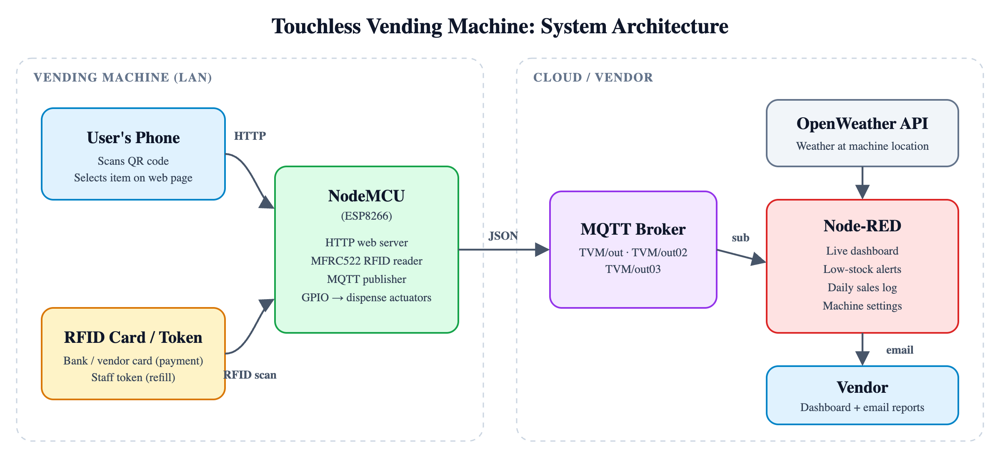
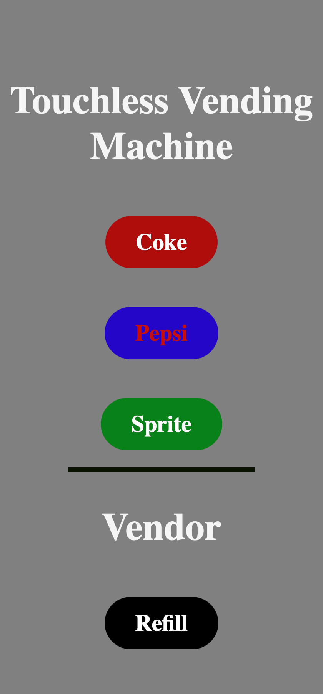
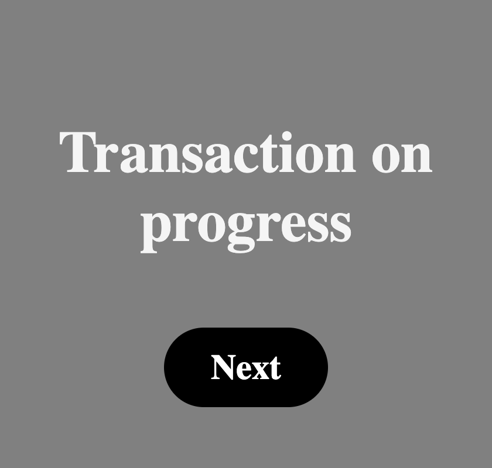
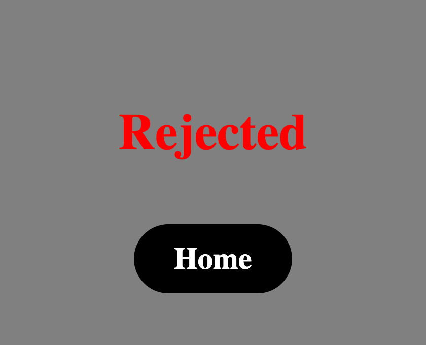

# Touchless Vending Machine

**A smart IoT system for contactless vending and remote machine monitoring.**

Customers pick products by scanning a QR code and pay by tapping an RFID card, so they never touch the machine. Vendors get a live dashboard, low-stock email alerts and daily sales reports for every machine.


---

## Table of Contents

- [The Problem](#the-problem)
- [Our Solution](#our-solution)
- [Features](#features)
- [System Architecture](#system-architecture)
- [How It Works](#how-it-works)
  - [Customer Flow](#customer-flow)
  - [Ground Staff (Refill) Flow](#ground-staff-refill-flow)
  - [Vendor Dashboard (Node-RED)](#vendor-dashboard-node-red)
- [Results](#results)
- [Benefits](#benefits)
- [Future Work](#future-work)

---

## The Problem

A normal vending machine needs physical contact in two places:

1. **Selecting** the food or beverage item on the keypad.
2. **Paying** with notes and coins.

During a pandemic, both are infection risks.

---

## Our Solution

| Step | Conventional Machine | Touchless Vending Machine |
|---|---|---|
| Select item | Press buttons on the machine | Scan a **QR code** and pick the item on a web page |
| Pay | Insert notes / coins | Tap a **bank credit/debit card** or a **vendor-issued RFID card** |
| Monitor stock | Manual checks | **Live dashboard** with email alerts |
| Sales records | Manual counting | **Automatic daily logs** and email reports |

---

## Features

### 👤 For Customers
- Contactless product selection through a QR code and web page
- Contactless payment through an RFID card (bank or vendor-issued)

### 🏪 For Vendors
- **Live dashboard** showing current stock, sales from the last 24 hours, last refill time and local weather
- **Email + dashboard alerts** when stock falls below a vendor-set threshold (at most one email every 6 hours, adjustable)
- **Daily sales log** saved to a file and emailed as a summary at the end of each day
- **Per-machine settings** for capacity, location and alert threshold
- **Weather updates** for the machine's location via the OpenWeather API, since weather strongly affects drink sales

### 🔧 For Ground Staff
- Refills are recorded through the same web page
- Access is authorized only with a specially issued **RFID token**; unknown tokens are rejected

---

## System Architecture

<p align="center"></p>
<p align="center"><i>Figure 1: System framework</i></p>

```
 ┌──────────────┐  HTTP (LAN)  ┌──────────────────┐   MQTT (JSON)   ┌──────────────┐
 │ User's Phone │ ───────────▶ │     NodeMCU      │ ──────────────▶ │ MQTT Broker  │
 │ (QR → Web UI)│              │ Web server + RFID│                 └──────┬───────┘
 └──────────────┘              │ + GPIO actuators │                        │
                               └──────────────────┘                        ▼
                                                               ┌────────────────────┐
                               OpenWeather API ──────────────▶ │      Node-RED      │
                                                               │ Dashboard · Alerts │
                                                               │ Logs · Email       │
                                                               └─────────┬──────────┘
                                                                         ▼
                                                                   Vendor (Email)
```

| Component | Role |
|---|---|
| **NodeMCU (ESP8266)** | Hosts the web server, reads RFID cards, publishes orders and refills over MQTT, drives the actuators through GPIO |
| **RFID reader** | Reads the customer's payment card or the staff's authorization token |
| **MQTT broker** | Carries JSON messages from the machine to the dashboard |
| **Node-RED** | Dashboard, alert logic, sales logging and email (runs locally or on IBM Cloud) |
| **OpenWeather API** | Weather at the machine's location |

---

## How It Works

### Customer Flow

1. The NodeMCU connects to the gateway/router and runs a **web server** (HTML, CSS, JavaScript) on its IP address.
2. The user scans the **QR code** on the machine and opens the web page on their phone, which must be on the same LAN.
3. The home page has a button for each product, plus a **service button** for ground staff.
4. When the user picks a product, the NodeMCU runs a C++ function that **starts an RFID scan** and reads the card details.
5. When the payment succeeds, the user is redirected to a transaction confirmation page. In this implementation, that page only demonstrates the transaction.
6. The NodeMCU **publishes the order as JSON** to the MQTT broker.
7. The NodeMCU uses **GPIO pins to drive the actuators** that dispense the item.

### Ground Staff (Refill) Flow

1. Staff press the **service button** on the web page.
2. The NodeMCU scans the RFID token and checks it against a pre-defined list of authorized IDs.
3. ✅ **Match:** redirect to the **Service Page**, where staff can record the refill.
   ❌ **No match:** redirect to a **rejected notice** page.
4. After the refill, a **refill notice is published** to the MQTT broker.

### Vendor Dashboard (Node-RED)

1. In the dashboard **Settings** tab, the vendor sets the machine **capacity, location and alert threshold**.
2. Node-RED **subscribes to the machine's MQTT topic** and converts the incoming JSON into a JavaScript object with the stock and refill data.
3. The dashboard updates **current stock**, **sales**, **last refill time** and **24-hour sales statistics** for each product.
4. Stock levels are compared against the threshold. When stock is low:
   - an **email alert** goes to the vendor (at most one every 6 hours, adjustable)
   - an **alert is pushed to the dashboard**
5. The **OpenWeather API** provides weather at the machine's location.
6. At the **end of each day**, the sales log file is updated and a **daily summary email** is sent.

<p align="center"></p>
<p align="center"><i>Figure 2: Node-RED flow for one machine</i></p>

---

## Results

### Customer: Product Selection & Payment

| Product Selection | RFID Payment | Transaction Complete |
|---|---|---|
|  |  |  |
| *Figure 4* | *Figure 5* | *Figure 6* |

### Ground Staff: Refill Authorization

| Authorized → Service Page | Unauthorized → Rejected |
|---|---|
|  |  |
| *Figure 7* | *Figure 8* |

### Vendor Dashboard

<p align="center"></p>
<p align="center"><i>Figure 9: Current stock, 24-hour sales, last refill time and weather</i></p>

<p align="center"></p>
<p align="center"><i>Figure 10: Per-machine settings (location, capacity, alert threshold)</i></p>

### Low-Stock Alerts

| Dashboard Alert | Email Alert |
|---|---|
|  |  |
| *Figure 11* | *Figure 12* |

### Daily Sales Reports

| Sales Log File | Daily Email Summary |
|---|---|
|  |  |
| *Figure 13* | *Figure 14* |

---

## Benefits

- **🦠 Hygienic:** customers never touch the machine, which matters during a pandemic.
- **💰 Lower manufacturing cost:** no complex note and coin detection and counting mechanism is needed.
- **🔒 Safer:** no cash in the machine means no robbery risk, and no risky periodic cash collection.
- **📦 Never out of stock:** low-stock alerts let ground staff refill in time, keeping supply continuous and revenue up.
- **🚚 Lower logistics costs:** stock visibility helps managers plan refill routes.
- **🔌 Easy to retrofit:** can be added to existing machines at low cost, either alongside cash payment or replacing it completely.
- **📈 Scalable:** works with any number of machines and adapts to other kinds of vending machines with small changes.

---

## Future Work

- **Sales prediction with machine learning:** once enough sales and weather data has been collected, deploy a **TensorFlow.js** model in Node-RED to predict demand.
- Use the predictions to **plan refill routines** and further reduce logistics costs.

---

<p align="center"><i>Built with NodeMCU · MQTT · Node-RED · OpenWeather API</i></p>
